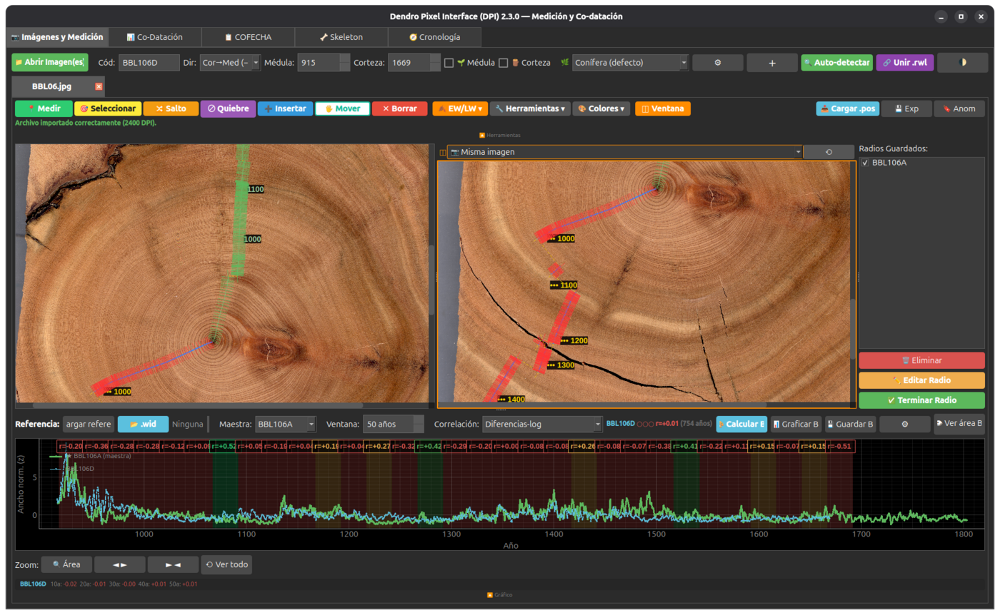
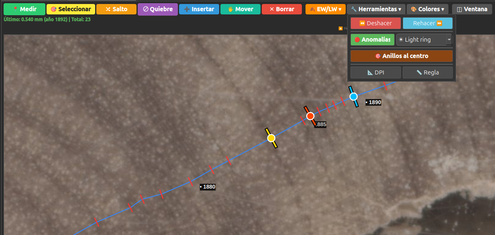
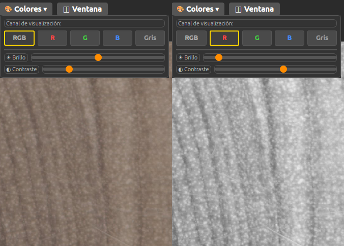
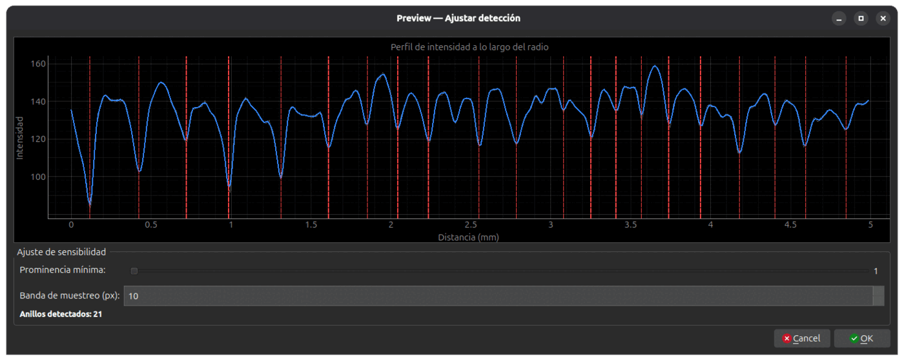
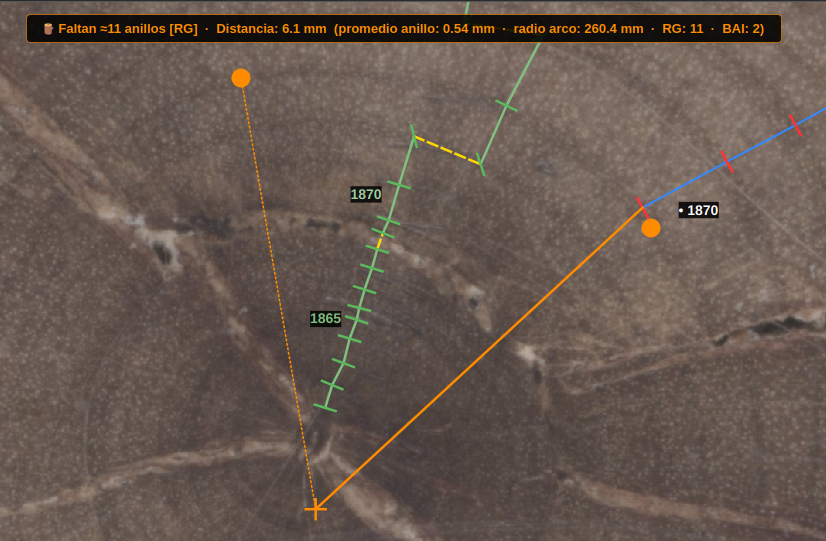
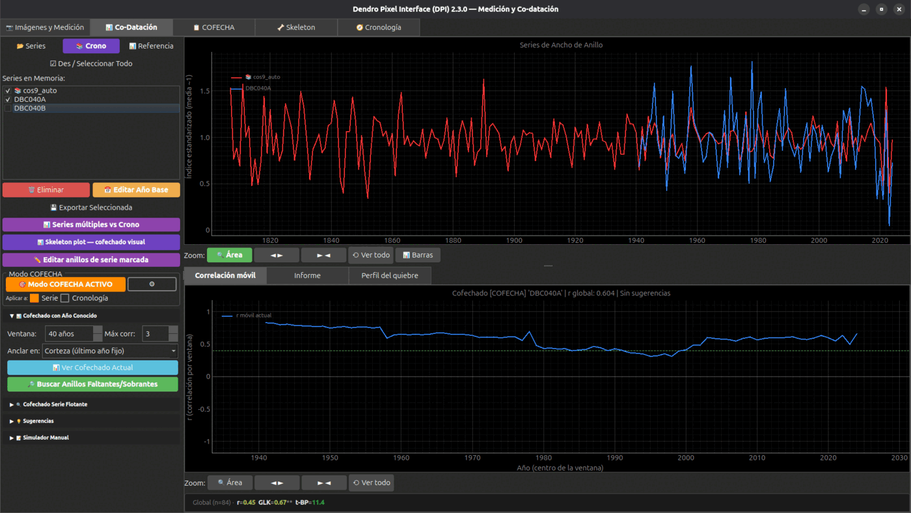
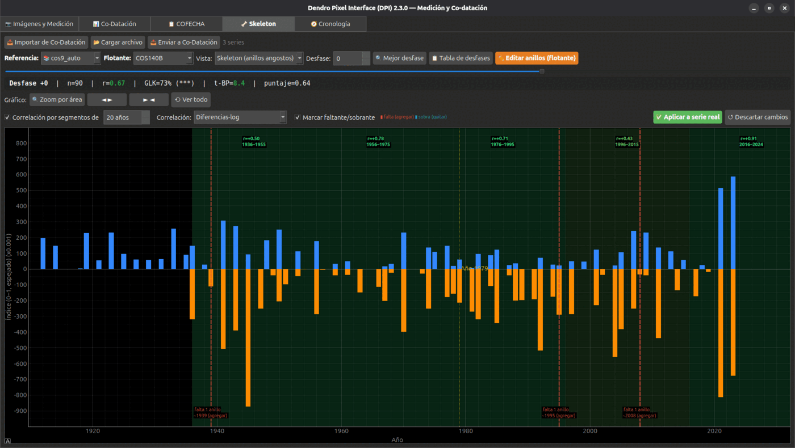
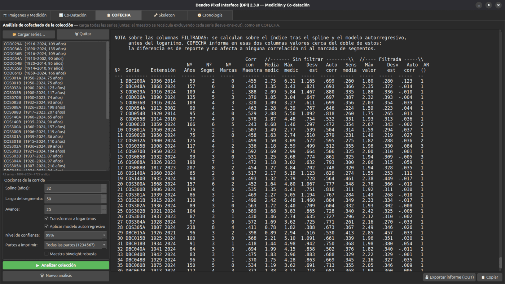
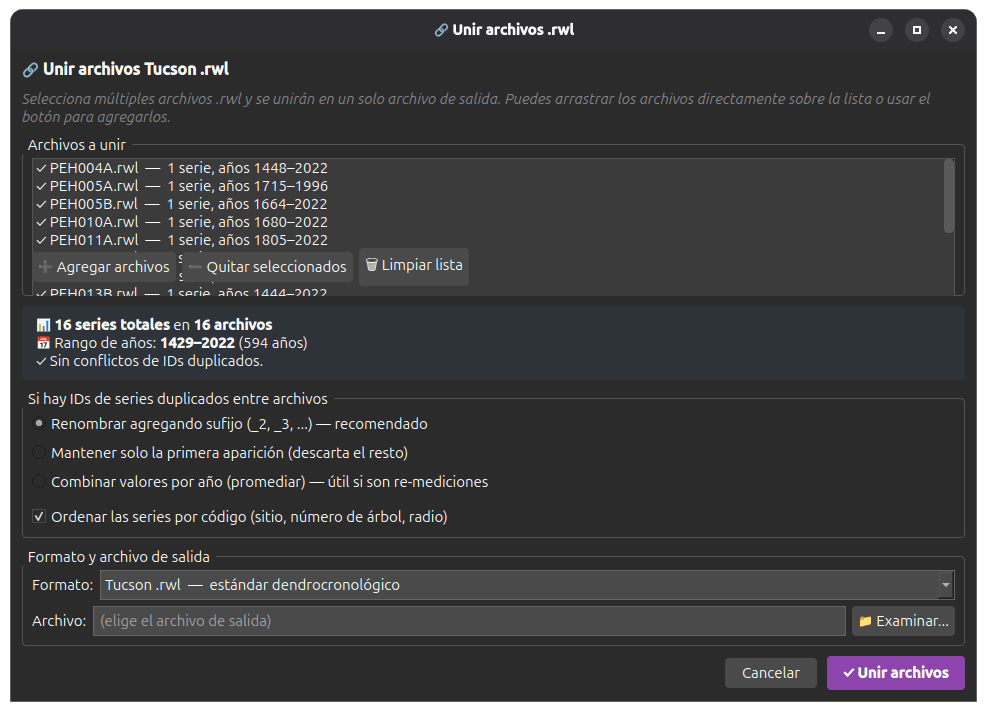

# Manual de DPI

Esto es la receta, no la referencia. La lista completa de funciones está en el
[README](README.md); el detalle de cada decisión y sus mediciones, en el
[CHANGELOG](CHANGELOG.md). Acá está lo que necesitas para abrir una imagen y
terminar con una serie cofechada.

---

## El mapa

Cinco pestañas, y el trabajo pasa por ellas en este orden:

| Pestaña | Para qué |
|---|---|
| 📷 **Imágenes y Medición** | Marcar los límites de anillo sobre la imagen |
| 📊 **Co-Datación** | Comparar contra una referencia y encontrar el año del error |
| 🦴 **Skeleton** | Confirmar a ojo antes de aplicar una corrección |
| 📋 **COFECHA** | Diagnóstico de la colección completa |
| 🧭 **Cronología** | Armar la maestra y sus estadísticos |

No tienes que exportar ni cambiar de programa entre una y otra.

---

## Instalar

Todo se descarga desde **<https://rojasbadillamoi.github.io/>**, en la
**[página de DPI](https://rojasbadillamoi.github.io/DPI/)**.

**Se instala como cualquier otro programa: doble clic y seguir los pasos.**

| Sistema | Archivo | Qué hacer |
|---|---|---|
| **Windows 10/11** | `.exe` | Doble clic en el instalador y siguiente, siguiente. DPI queda en el menú de inicio. |
| **Debian / Ubuntu** | `.deb` | Doble clic: lo abre el Centro de Software (o GDebi, o el gestor que tengas) y le das instalar. DPI queda en el menú de aplicaciones, con su ícono en el dock. |

No hay que instalar Python ni nada más: los dos paquetes traen todo adentro.

> **Si Windows te muestra un aviso azul** que dice que no reconoce el programa,
> es porque el instalador no está firmado digitalmente —firmarlo cuesta una
> licencia anual—. Clic en **Más información → Ejecutar de todas formas**.

Si prefieres la terminal, el `.deb` también se instala así, y `apt` resuelve
las dependencias solo:

```bash
sudo apt install ./dendro-pixel-interface-dpi_*.deb
```

### Desde el código fuente

Para macOS, para otras distribuciones de Linux, o si quieres modificar el
programa. Necesitas Python 3.10 o superior. El `.zip` del código está en la
misma página, o clonas el repositorio:

```bash
git clone https://github.com/rojasbadillamoi/DPI.git
cd DPI
python3 -m venv venv && source venv/bin/activate
pip install -r requirements.txt
python3 run_dpi.py
```

Por este camino DPI no queda en el menú de aplicaciones. Para que aparezca
—también en Wayland—, córrelo una sola vez:

```bash
python3 instalar_lanzador_linux.py
```

---

## 1. Tu primer radio



### Abrir y calibrar

`📁 Abrir Imagen(es)`. Puedes cargar varias; cada una va en su pestaña.

Lo primero, antes de marcar nada: **confirma los DPI**. El programa los lee de
los metadatos de la imagen, y si no están usa 2400 por defecto. Si ese valor
está mal, todos tus anchos están mal por el mismo factor y nada en el cofechado
te lo va a decir —las correlaciones salen idénticas—.

- `🔧 Herramientas → 📐 DPI` si sabes la resolución del escáner.
- `🔧 Herramientas → 📏 Regla` si no: clic en dos puntos de distancia conocida.

### Marcar

`📍 Medir` (`Ctrl+A`). El **primer clic fija el ancla**, el extremo del radio.
Los clics siguientes van agregando límites desde ahí. No importa si mides de
médula a corteza o al revés; el ancla deja que extiendas en las dos direcciones.



Los modos que vas a usar de verdad:

| Modo | Atajo | Cuándo |
|---|---|---|
| 📍 Medir | `Ctrl+A` | Marcar límites |
| ➕ Insertar | `Ctrl+W` | Se te pasó un anillo entre dos puntos ya marcados |
| 🖐 Mover | `Ctrl+S` | Un punto quedó corrido. También hace pan de la imagen |
| ✕ Borrar | `Ctrl+X` | Marcaste de más |
| 🔀 Salto | `Ctrl+D` | Grieta o zona ilegible: la distancia no cuenta como anillo |
| ⊘ Quiebre | `Ctrl+E` | Hueco **dentro** de un anillo: suma la distancia, no cierra el anillo |

`Ctrl+Z` / `Ctrl+Y` deshacen y rehacen hasta 50 pasos.

### Los metadatos, en la barra de arriba

**Cód** (8 caracteres), **Dir** (médula→corteza o al revés), y **Médula** /
**Corteza**: cambias uno y el otro se recalcula solo. Los casilleros
🌱 **Médula** y 🪵 **Corteza** indican si la muestra llega *físicamente* al
centro o a la corteza — no es lo mismo que el año, y es el dato que después
necesitas para el pith offset y para el ITRDB.

### Mirar bien

- **Canales y contraste** (`1`–`5` para RGB, R, G, B, Gris). En latifoliadas
  difíciles el canal azul o el rojo separan el límite que en RGB no se ve. El
  ajuste queda guardado por especie y por canal.

  

- **Vista dividida** (`Ctrl+B`): un segundo panel con su propio zoom. Sirve
  para tener el centro a la vista mientras trabajas en la corteza, o para poner
  dos muestras lado a lado.
- **El gráfico en vivo**: haz clic en un año del gráfico y la imagen se centra
  en ese anillo. Es la forma más rápida de ir a ver un valor que se ve raro.

### Leño temprano y tardío

Si necesitas separar earlywood de latewood, DPI guarda **un límite EW/LW por
anillo**, dentro del anillo ya medido.

- **A mano**: `🍂 EW/LW → 🍂 Marcar EW/LW` (`Ctrl+L`) y clic sobre la línea
  azul del anillo que quieres partir.
- **Automático**: `🍂 EW/LW → 🔍 Auto-detectar EW/LW` procesa todos los anillos
  del radio activo en segundo plano, con barra de progreso y botón de cancelar.
  Busca el punto de **máxima tasa de oscurecimiento** a lo largo del anillo, que
  es la transición EW → LW; si el perfil no muestra oscurecimiento, cae al
  primer cruce por debajo de su media.
- **Borrar todo**: `🍂 EW/LW → 🗑 Eliminar todos EW/LW`.

Lo automático funciona bien en coníferas con transición marcada y mal en
latifoliadas de porosidad difusa. Revísalo con el mismo criterio que la
autodetección de anillos: te ahorra el grueso, no la revisión.

---

## 2. Autodetección

Para radios limpios ahorra la mayor parte del trabajo. Para los demás, ayuda y
no reemplaza el ojo — asume que vas a corregir.

1. Elige la especie en el combo `🌿` de la barra superior.
2. `🤖 Auto-detectar`.
3. Clic en la médula, clic en la corteza.
4. Se abre la previsualización. Mueves la **prominencia mínima** hasta que el
   número de anillos detectados sea razonable, y confirmas.



Esa ventana es la parte importante: el perfil de intensidad a lo largo del
radio, con una línea roja por cada límite propuesto. Un valle profundo y
angosto es un límite real; una ondulación suave casi nunca lo es.

Si ya tenías puntos en ese tramo, el programa pregunta si reemplazarlos o
insertar sin borrar.

Los parámetros se guardan por especie en `species_profiles.json`. Vale la pena
afinar un perfil por especie la primera vez y reusarlo siempre; el que viene es
genérico para coníferas.

---

## 3. Médula faltante

Cuántos anillos hay entre el primer anillo que mediste y el centro real.



`🔧 Herramientas → 🎯 Anillos al centro` (`Ctrl+P`), y eliges método:

- **Arco**: marcas 3 o más puntos sobre la curvatura interna visible. Ajusta el
  círculo por mínimos cuadrados y te muestra el centro en vivo mientras marcas.
- **DAP manual**: para tarugos rectos sin curvatura. Ingresas el diámetro.
- **Serie de referencia**: escala el crecimiento de una serie ya cargada en vez
  de suponer ancho constante. Es el más realista cuando tienes una referencia
  cofechada.

> **El cálculo no se guarda solo.** Al terminar de marcar, aprieta `ENTER` o
> **📐 Ver resultado** para abrir el cuadro con el rango de incertidumbre y el
> botón de aplicar. Si cambias de herramienta con un cálculo pendiente, el
> programa pregunta antes de descartarlo.

Con **📄 Guardar estimación** se exporta a un Excel aparte. **No entra al
`.rwl`**, y es a propósito: ese archivo lleva anchos medidos, y meter anillos
estimados contaminaría el cofechado de toda la colección.

---

## 4. Varios radios y exportar

Para una sección con radios A, B, C:

1. Mides el primero.
2. `💾 Guardar radio`, le das identificador.
3. El lienzo queda limpio para el siguiente. Los guardados quedan superpuestos
   en colores distintos, y los activas o apagas desde la lista de la derecha.

`💾 Exportar` ofrece Tucson (`.rwl`/`.txt`), CSV o Excel. Las anomalías, los
casilleros de médula/corteza y el pith offset van automáticamente a un archivo
lateral oculto `.<nombre>.anom.json`, que se vuelve a cargar solo cuando
reimportas el `.rwl`.

El progreso se guarda solo mientras mides, en un archivo lateral junto a la
imagen. Si se cierra el programa, al reabrir la imagen está todo.

---

## 5. Co-datación



Cargas las series (`.rwl`, `.txt`, `.wid`), designas una como maestra, y el
panel de abajo muestra la **correlación móvil**: la r de cada ventana de 40
años a lo largo de la serie.

Los colores de los segmentos:

- **Verde** — bien cofechado (`r ≥ 0.40`).
- **Rojo** — probable error de fechado (`r ≤ 0.25`).
- **Amarillo** — hay otra posición que mejoraría la correlación: huele a anillo
  faltante o sobrante.

Lo primero que hay que leer no es el color sino la **forma de la caída**:

> Una caída que **se recupera** sola más adelante es un error de datación —un
> anillo de más o de menos que después se compensa—. Una caída que **no se
> recupera** es otra cosa: supresión, daño, serie mal asignada. El localizador
> de quiebres sirve para la primera, no para la segunda.

---

## 6. Cuando una serie no cofecha

Esta es la parte que distingue a DPI, y conviene seguirla en orden.

1. **Mira la correlación móvil** y decide de qué tipo es el problema (arriba).
2. **Buscar anillos faltantes o sobrantes**, con el máximo en 1 o 2 para
   empezar. Subirlo sin necesidad solo agrega hipótesis.
3. **Lee el informe antes que la tabla.** La tabla da años; el informe dice
   *cuántos* anillos, *en qué dirección* y *con cuánto respaldo*. Te va a decir
   «hay que insertar 1 anillo entre 1847 y 1863», no «+1».
4. **Mira el perfil del quiebre.** Si es un pico angosto, el año está
   determinado. Si es una meseta, elegir un año sería falsa precisión — revisa
   el rango completo.
5. **Empieza por los años que te ordena**, no por el principio de la ventana.
   Los ordena por lo estrecho que es cada año en la cronología, porque un
   anillo ausente aparece donde el árbol casi no formó leño.
6. **Confírmalo en el skeleton.** La decisión final es visual.
7. **Vuelve a COFECHA** y verifica que el segmento quedó limpio.

Las correcciones se aplican **en memoria**: puedes probar el efecto en la
correlación móvil sin tocar los archivos del disco.

### Qué tan confiable es

Con errores introducidos en años conocidos sobre cuatro especies:

| escenario | la zona contiene el año | signo correcto |
|---|---|---|
| 1 anillo ausente o falso | 92–100 % | 83–100 % |
| 2–3 anillos del mismo tipo | 92–100 % | 67–100 % |
| ausente + falso que se cancelan | 42–45 % | — |

El último caso es un límite real del método: si los dos errores se compensan,
el desplazamiento neto es cero y ninguna partición lo revela. **En esos casos
el programa se calla en vez de inventar**, y eso es justamente lo que quieres.

Y antes de pronunciarse, la búsqueda se contrasta contra el azar: DPI mide
cuánto gana la misma búsqueda aplicada a las otras series de la colección, que
ya están fechadas, y solo habla si lo supera. Eso deja 0–11 % de falsos
positivos con 78–100 % de detección.

---

## 7. Skeleton



El método clásico, digitalizado. Eliges referencia y serie flotante, el
programa prueba desfases y te muestra el mejor, con la r, el GLK y el t de
Baillie-Pilcher de cada tramo.

Dos usos:

- **Confirmar una corrección** antes de aplicarla: las marcas rojas de «falta 1
  anillo» aparecen sobre el año propuesto y ves si calza con los anillos
  angostos de la referencia.
- **Enseñar.** Es lo primero que se pasa en un curso de dendro y casi nadie lo
  tiene digitalizado.

---

## 8. COFECHA



Cargas todas las series juntas y `▶ Analizar colección`. El maestro se
recalcula excluyendo cada serie —leave-one-out—, igual que COFECHA.

Las opciones por defecto (spline 32 años, segmentos de 50 con avance de 25,
logaritmos, modelo autorregresivo) son las de COFECHA. Cámbialas solo si sabes
por qué.

**Cómo leer la salida.** La columna que importa es **Corr con Maestra**. Las
dos mitades de la tabla, «Sin filtrar» y «Filtrada», no son dos análisis: la
filtrada es sobre el índice después del spline y el modelo AR, antes del
logaritmo. COFECHA informa esas columnas cerca del doble de estas; es
diferencia de reporte y no afecta a ninguna correlación ni al marcado de
segmentos.

La columna **N° Marcas** es por dónde empezar: son los segmentos que cayeron
bajo el umbral. Ojo con la trampa de siempre —COFECHA marca segmentos también
en series bien fechadas—, y por eso el paso siguiente es el localizador de
quiebres y no corregir a ciegas.

`💾 Exportar informe (.OUT)` entrega el archivo de siete partes, el mismo que
ya sabes leer.

**Fidelidad y velocidad.** Reimplementado desde el artículo de Holmes (1983) y
el manual de la DPL, no desde el código de COFECHA. Error medio por serie de
0,018 contra corridas reales, y cero discrepancias en los umbrales de 0,30 y
0,40 sobre 238 series. 1600 series en 8,8 segundos, en segundo plano y con
botón de cancelar.

---

## 9. Cronología

Construye `raw`, `standard` y `residual`, con cinco métodos de estandarización
y tres de agregación.

Dos cosas que conviene saber antes de leer los estadísticos:

- **El Rbar es entre árboles.** Dos radios del mismo árbol comparten el
  individuo, no solo el sitio. Contarlos como réplica independiente infla el
  Rbar, la EPS y la SSS. DPI separa las series por árbol y calcula el Rbar
  efectivo.
- **Mira la SSS, no solo la EPS.** La EPS te compara contra una población
  infinita de árboles; la SSS, contra la colección que realmente tienes. Para
  decidir desde qué año usar la cronología, la segunda es la pregunta correcta.

Si una curva de ajuste cruza cero o se le acerca, el índice se dispara. DPI
descarta la curva completa —como ARSTAN y dplR— y abre un diálogo con las cinco
curvas superpuestas para que elijas otra, por grupo o por serie.

**Alcance:** esto es para cofechar y para ver cómo va la colección. No pretende
reemplazar a ARSTAN para la cronología que vas a publicar.

---

## 10. Unir archivos



Combina varios Tucson en uno. Si hay códigos repetidos entre archivos, tres
salidas: renombrar con sufijo (`_2`, `_3`), quedarse con la primera aparición,
o promediar por año — esta última **solo** si de verdad son re-mediciones de la
misma serie.

El casillero de ordenar lee `QLH107A` como tres cosas —sitio, árbol, radio— y
no como una cadena. Alfabéticamente saldría `COS1, COS10, COS2`. Sirve también
para ordenar un archivo ya unido.

---

## 11. Sacar las figuras

El botón `💾 Descargar` está en la barra de zoom, bajo los gráficos. **No es una
captura de pantalla**: DPI vuelve a dibujar la figura con matplotlib, así que la
calidad no depende del tamaño que tenga la ventana en ese momento.

| Opción | Qué elegir |
|---|---|
| **Paleta** | Claro, Oscuro, Alto contraste o Sepia. Son las mismas de Veta, para que las figuras de las dos herramientas se vean como parte del mismo trabajo. |
| **Formato** | PNG para pegar en un documento; SVG o PDF si quieres una figura vectorial que se pueda editar después. |
| **Resolución** | 300 dpi es lo que piden casi todas las revistas. Solo afecta al PNG: SVG y PDF son vectoriales y el control se desactiva solo. |
| **Tamaño** | Ancho y alto en centímetros, 24 × 12 por omisión. En centímetros y no en píxeles porque así es como las revistas piden el ancho de columna. |

Dos detalles que ahorran trabajo:

- **Puedes trabajar en oscuro y exportar en Claro o Sepia.** La paleta de la
  figura es independiente del tema del programa.
- **Se exporta exactamente lo que estás viendo.** Si ocultaste una serie desde
  la leyenda, no sale en la figura.

Las preferencias —paleta, formato, resolución, tamaño— y la carpeta de la última
figura quedan guardadas, así que la segunda figura sale con dos clics.

---

## Atajos

**Modos:** `Ctrl+A` medir · `Ctrl+D` salto · `Ctrl+E` quiebre · `Ctrl+W`
insertar · `Ctrl+S` mover · `Ctrl+X` borrar · `Ctrl+L` EW/LW · `Ctrl+Q`
anomalías · `Ctrl+P` médula

**Edición:** `Ctrl+Z` deshacer · `Ctrl+Y` rehacer

**Vista:** `Ctrl+B` vista dividida · `1`–`5` canal RGB/R/G/B/Gris · rueda del
ratón zoom · botón central pan

**En modo médula:** `Enter` confirma · `Esc` cancela

---

## Problemas frecuentes

| Síntoma | Causa casi siempre |
|---|---|
| Los anchos salen con un factor raro | DPI de la imagen mal detectado. Calíbralo con la regla |
| La autodetección encuentra el doble de anillos | Prominencia muy baja, o canal equivocado para esa especie |
| La autodetección encuentra la mitad | Prominencia muy alta, o la banda de muestreo cruza una grieta |
| Todas las correlaciones salen bajas | Casi siempre la maestra, no la serie: revisa que esté bien fechada y que solape de verdad |
| El pith offset no aparece en el `.rwl` | Es a propósito — va al Excel aparte |
| Las anomalías no reaparecen al reimportar | El archivo `.anom.json` quedó en otra carpeta: viaja junto al `.rwl` |
| Una serie aparece dos veces en COFECHA | Código duplicado dentro del archivo; únelo con la opción de renombrar |

---

## Cómo citar

> Rojas-Badilla, M.E. (2026). *DPI — Dendro Pixel Interface*. Zenodo.
> https://doi.org/10.5281/zenodo.22780901

Si tu trabajo se apoya en los métodos, cita también las fuentes originales:
Holmes (1983) para el control de calidad, Cook y Peters (1981) para el spline,
Grissino-Mayer (2001) para el uso de COFECHA, y Maxwell et al. (2017) si usas
intensidad de madera.

---

*Manual de **DPI 2.4.1**. Las capturas se tomaron en 2.3: entre esa versión y
esta cambió el orden de las pestañas, no su contenido.
Software libre bajo GPL v3 · <https://rojasbadillamoi.github.io/DPI/>
Dudas y errores: moisese.rojasbadilla@gmail.com*
